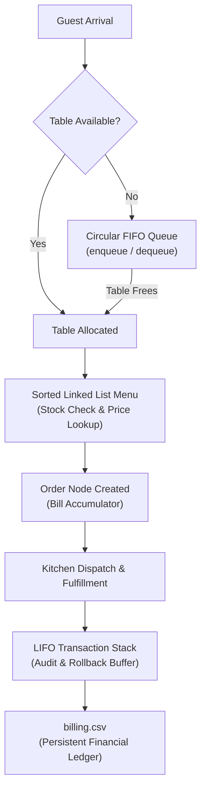

# 🍽️ DineTrack — Modular Restaurant Management System in C

[](https://github.com/Tanmayi-n14/dinetrack-restaurant-management-DSA/actions/workflows/ci.yml)
[](https://en.wikipedia.org/wiki/C11_(C_specification))
[](https://gcc.gnu.org/)
[](#-data-structures-architecture--complexity)
[](https://opensource.org/licenses/MIT)

A high-performance, modular restaurant POS, order tracking, and table seating management system written in pure **C**. Designed to demonstrate practical implementations of core classical data structures — **Circular FIFO Queues**, **LIFO Transaction Stacks**, and **Dynamic Sorted Linked Lists** — with file persistence and transaction rollback.

Developed as the **Core Course Project** for **Data Structures & Algorithms in C (UE23CS201)** at **PES University**.

---

## 📌 Features & Functional Modules

- **📋 Dynamic Menu Inventory**: Sorted linked list representation of 15+ dishes with real-time stock decrements and price lookups.
- **🚶 Waiting List Queue (Circular FIFO)**: Fair table management for walk-in guests with capacity enforcement.
- **🧾 Order Lifecycle Pipeline**: Real-time kitchen tickets tracking dish IDs, quantities, total billing, and VIP customer status.
- **⏪ LIFO Transaction History & Undo**: Stack-based order history enabling reverse audits and billing cancellations.
- **💾 Persistent Financial Ledger**: Automatically records finalized orders, timestamps, and customer names to `billing.csv`.

---

## 🗺️ System Workflow Architecture



---

## 📐 Data Structures Architecture & Complexity

Each data structure in DineTrack is selected based on algorithmic constraints and operational requirements:

| Module / Operation | Data Structure | Time Complexity | Memory Complexity | Algorithmic Justification |
| :--- | :--- | :---: | :---: | :--- |
| **Customer Waiting List** | **Circular FIFO Queue** | $\mathcal{O}(1)$ Enqueue / Dequeue | $\mathcal{O}(K)$ | Guarantees fair first-come, first-served customer seating without array shifting. |
| **Transaction History & Undo** | **LIFO Stack** | $\mathcal{O}(1)$ Push / Pop | $\mathcal{O}(N)$ | Enables instantaneous reversal of the most recent billing transaction. |
| **Menu & Inventory Catalog** | **Sorted Singly Linked List** | $\mathcal{O}(N)$ Search, $\mathcal{O}(1)$ Insert | $\mathcal{O}(M)$ | Dynamic heap allocation allows adding or removing menu items without array reallocations. |
| **Order Processing Pipeline** | **Doubly Linked Ticket Nodes** | $\mathcal{O}(1)$ Append, $\mathcal{O}(1)$ Delete | $\mathcal{O}(T)$ | Enables rapid ticket deletion when kitchen completes an order. |

---

## 💻 Terminal User Interface Preview

```text
-------------------- MENU --------------------
 1. Dosa               Rs   40 (Stock:  30)
 2. Idli               Rs   30 (Stock:  50)
 3. Pongal             Rs   50 (Stock:  20)
 4. Tea                Rs   15 (Stock: 100)
 5. Coffee             Rs   20 (Stock: 100)
 6. Meals              Rs   80 (Stock:  25)
 0. Finish adding items
----------------------------------------------
```

---

## 🛠️ Build & Run Instructions

### Prerequisites
A C compiler (`gcc` or `clang`) and `make`:
- **Ubuntu/Debian**: `sudo apt install build-essential`
- **macOS**: `xcode-select --install`
- **Windows**: MinGW-w64 or WSL

### Compilation
Using `make` (enforces `-Wall -Wextra -O2`):
```bash
make
./dinetrack
```

Or direct compilation with `gcc`:
```bash
gcc -Wall -Wextra -O2 src/DineTrack.c -o dinetrack
./dinetrack
```

---

## 📂 Repository Contents

```text
dinetrack-restaurant-management-DSA/
├── .github/
│   └── workflows/
│       └── ci.yml               # Automated GCC compilation and CI workflow
├── src/
│   └── DineTrack.c              # Core C implementation (Queue, Stack, Linked List)
├── Makefile                     # Build targets (all, run, clean)
└── README.md                    # Technical documentation & Big-O analysis
```

---

## 👤 Author

* **Tanmayi Nagabhairava** ([@Tanmayi-n14](https://github.com/Tanmayi-n14)) — `PES1UG24CS493`
* Department of Computer Science & Engineering, PES University
